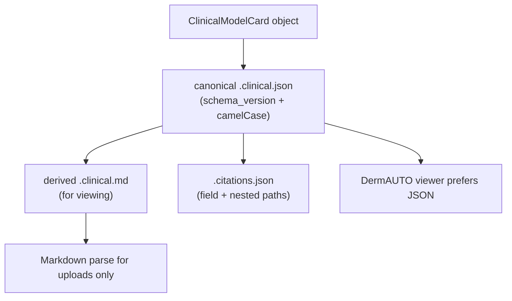
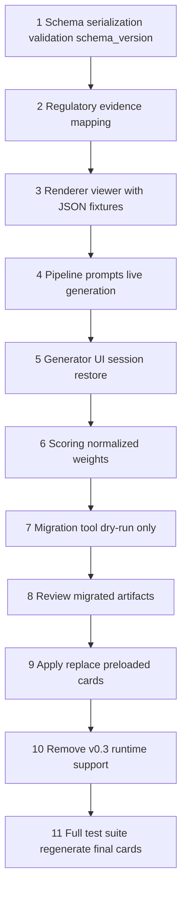

# Clinician-Centered Model Card Migration Plan (v1.0)

## Goal

Replace the 74-field CHAI v0.3 model card with a finalized clinician-centered schema (6 sections, 28 displayed clinical fields). Use **snake_case** in Python, **camelCase** in JSON/Markdown exports, **`date` types** internally, and **`schema_version: "clinical-model-card-1.0"`** on all serialized artifacts.

Run a **deterministic, non-destructive, idempotent migration** with audit reports and manual approval before replacing preloaded cards. **Validate** migrated output, **back up** originals, then **remove** CHAI v0.3 parsing and schema support.

## Confirmed decisions

- Python: `snake_case` internally; JSON/Markdown export keys: `camelCase`
- **JSON is the canonical machine-readable artifact**; Markdown is generated for human viewing
- Viewer prefers `.clinical.json` when both JSON and MD exist
- Migration: deterministic by default; LLM only for explicitly flagged concise-merge fields
- `release_date` is **never** used as `regulatory_approval_date`
- Regulatory enum requires evidence hierarchy; LLM may normalize supported evidence only
- Summary: rewrite-if-invalid, never mechanical truncation
- Regulatory color applies **only** to the status badge/row — not Metadata section header or other fields
- v0.3 parser kept alive until all 6 cards migrate successfully and outputs are manually approved

---

## Target schema

### Serialization metadata (not displayed clinical fields)

```python
schema_version: str = "clinical-model-card-1.0"  # always present in JSON + MD frontmatter
```

Viewer checks `schema_version` first. If absent or `chai` / v0.3 → clear error: "This card uses the legacy CHAI v0.3 format."

### Date semantics

| Field | Python type | Meaning | Source rules |
|-------|-------------|---------|--------------|
| `regulatory_approval_date` | `date \| None` | Date of FDA/CE/EUA authorization from an **authoritative regulatory record** | FDA API decision date, explicit clearance/approval date in cited regulatory source. **Never** from `release_date`, model version date, or card extraction date. `None` → render "Not disclosed" |
| `last_updated` | `date` | **Model card document** last-updated date (not model validation date, not regulatory date) | Migration: date migration script runs OR legacy `extraction_timestamp` parsed as card update date. Live pipeline: generation date. Document this explicitly in field help text |

### Optionality and missingness

**"Required" means the key must exist in the dataclass/JSON**, not that content must be fabricated.

| Pattern | Internal | JSON export | UI render |
|---------|----------|-------------|-----------|
| Evidence-dependent text | `str \| None` | `null` or omit nested key | "Not disclosed" |
| Manufacturer literally said "Not disclosed" | `str` value `"Not disclosed"` | same | "Not disclosed" (distinct from `null` in audit) |
| `scheduled_updates` | `str \| None` | `null` | "Not disclosed" |

Fields using `None` for missing evidence: `availability`, `regulatory_approval_date`, `clinical_trial`, `training_data.dataset_url`, `contact.email`, `contact.url`, `scheduled_updates`, `ongoing_monitoring_plan` (when no evidence).

Fields that must have non-`None` string content after generation (may be short): `model_name`, `developer`, `version`, `summary`, `medical_purpose`, `acceptable_input`, `output`, `role_in_decision_making`, `intended_users`, `target_patient_population`, all Risks fields, `model_type`, `training_data.description`, `performance.summary`, `performance_evaluation_limitations`.

`regulatory_approval_status` must always be a valid enum; `UNKNOWN` is valid when evidence is insufficient.

### Regulatory provenance (pipeline metadata, not a displayed field)

Stored in citations sidecar and pipeline `sources` dict:

```python
regulatory_status_source: str | None  # e.g. "fda_api:K123456", "citation:3", "conservative_text_map"
regulatory_status_evidence: list[Citation]  # URLs/snippets supporting the enum
regulatory_status_confidence: Literal["authoritative", "cited_explicit", "conservative_map", "unknown"]
```

### Regulatory enum → UI tier (status badge/row only)

| Enum | Tier | Display label |
|------|------|---------------|
| `NOT_AUTHORIZED_CONSUMER_TOOL` | red | Not Authorized / Consumer Tool |
| `INVESTIGATIONAL_RESEARCH_USE_ONLY` | orange | Investigational / Research Use Only |
| `EUA_AUTHORIZED` | yellow | EUA Authorized |
| `FDA_APPROVED`, `FDA_CLEARED` | green | FDA Approved or Cleared |
| `CE_MARKED` | blue | CE Marked |
| `UNKNOWN` | gray | Regulatory Status Unknown |

**UI rule:** Apply tier color **only** to the Regulatory Approval Status badge or that field's row. Do not color the Metadata section header, `model_name`, `developer`, or other metadata fields.

### Evidence hierarchy for regulatory status (mandatory)

LLM **must not** independently decide FDA cleared/approved. Classification order:

1. **Authoritative regulatory source** — FDA API (`fda_discovery`), accessdata.fda.gov record with explicit decision/clearance date → enum + `regulatory_approval_date` + `regulatory_status_source: "fda_api:..."`
2. **Explicit regulatory language in cited manufacturer or publication source** — only when citation URL is manufacturer site, FDA, EMA, or peer-reviewed paper quoting regulatory status → enum from conservative regex map on cited snippet; LLM may normalize phrasing **only** within the enum set, not upgrade tier
3. **Conservative text mapping** — regex on legacy `regulatory_approval_status_if_applicable` field text (no citation) → enum with `confidence: conservative_map`; if ambiguous marketing language ("FDA-grade", "clinically validated") → `UNKNOWN`
4. **Otherwise** → `UNKNOWN`

**Penalize unsupported certainty, not honest uncertainty:** scorer flags enum values assigned at `authoritative` or `cited_explicit` without matching evidence in sidecar; does **not** penalize `UNKNOWN`.

---

## Canonical artifact flow



**Pipeline writes:** `{slug}.clinical.json` (canonical), `{slug}.clinical.md` (derived), `{slug}.citations.json` (sidecar).

**DermAUTO viewer load order:**
1. If `{basename}.clinical.json` exists → `ClinicalModelCard.from_dict()` → render
2. Else if uploaded/selected `.clinical.md` with `schema_version` frontmatter → parse MD (secondary)
3. Else if v0.3 detected → error message (post-gate); during migration only, v0.3 parser still available internally

---

## Citation preservation (explicit spec)

### Sidecar schema (`*.citations.json`)

```json
{
  "schema_version": "clinical-model-card-citations-1.0",
  "fields": {
    "regulatory_approval_status": [{"url": "...", "snippet": "...", "legacy_fields": ["regulatory_approval_status_if_applicable"]}],
    "performance.metrics[0]": [{"url": "...", "snippet": "...", "legacy_fields": ["usefulness_efficacy_result"]}],
    "known_failure_modes": [{"url": "...", "legacy_fields": ["skin_type_representation_and_equity", "model_limitations"]}]
  },
  "regulatory_status_source": "fda_api:K123456",
  "regulatory_status_evidence": [...],
  "_sources_metadata": {}
}
```

### Rules

| Concern | Rule |
|---------|------|
| Top-level fields | Citation key = snake_case field name |
| Nested fields | Dot + bracket paths: `training_data.dataset_url`, `performance.metrics[0]` |
| Sidecar file | `{basename}.citations.json` alongside canonical JSON |
| Migration | Union citations from all legacy source fields contributing to a target field; preserve original URLs; record `legacy_fields` list per citation |
| Synthesized values | Must cite **all** legacy source fields used; never add citations for facts not in legacy card or its cited sources |
| Markdown export | `to_markdown(card, citations)` embeds inline `[n]` refs from sidecar; `## References` section generated from union of URLs |
| Regulatory | `regulatory_status_evidence` must be non-empty when enum is not `UNKNOWN` and confidence is `authoritative` or `cited_explicit` |

---

## Summary length enforcement (no truncation)

**Never** mechanically truncate clinical text.

Use conservative sentence counting via new helper [`src/utils/sentence_utils.py`](src/utils/sentence_utils.py) (no existing tokenizer in project):

- `count_sentences(text) -> int` with tests for: `U.S.`, `e.g.`, `et al.`, decimals (`95.5%`), URLs, model-name abbreviations
- Do **not** split on every `.` / `!` / `?` naively

**`_enforce_summary_length()` behavior:**

1. If `count_sentences(summary) <= 3` → pass
2. Else → ask generation step (Gemini) to **rewrite** concisely in ≤3 sentences, preserving input/output/clinical-role content
3. Revalidate rewritten summary with `count_sentences`
4. If still >3 sentences → **keep original**, emit `validation_warnings: ["summary_exceeds_three_sentences"]`; never cut text
5. Migration uses same rule; deterministic merge that exceeds 3 sentences → flag for manual review, do not auto-truncate

---

## Scoring weights (normalized to 1.0)

Store raw importance points, normalize programmatically:

```python
RAW_FIELD_POINTS = {
    "medical_purpose": 12,
    "role_in_decision_making": 12,
    "required_clinician_oversight": 10,
    "known_failure_modes": 10,
    "performance": 12,
    "regulatory_approval_status": 8,  # evidence quality scored separately
    "acceptable_input": 8,
    "output": 8,
    "summary": 8,
    "unsupported_clinical_scenarios": 8,
    "target_patient_population": 6,
    "intended_users": 6,
    "model_type": 4,
    "training_data": 4,
    "model_development_and_validation": 4,
    "performance_evaluation_limitations": 4,
    "unsupported_use_cases": 4,
    "ongoing_monitoring_plan": 2,
    "scheduled_updates": 2,
    "contact": 2,
    "developer": 2,
    "model_name": 2,
    "version": 2,
    "last_updated": 1,
    "availability": 1,
}
# Sum = 130; weight(field) = points / 130
```

**Evidence-quality penalties (separate from completion):**
- Enum not `UNKNOWN` but `regulatory_status_confidence` is not `authoritative` or `cited_explicit` → warning
- Enum is `FDA_CLEARED` / `FDA_APPROVED` with no `regulatory_status_evidence` → critical issue
- `UNKNOWN` enum → **no penalty** (honest uncertainty)

---

## Exhaustive v0.3 field mapping (updated)

Actions: **DIRECT**, **MERGE** (deterministic), **SYNTHESIZE_LLM** (explicit flag only), **DROP**.

### Date field corrections

| Legacy field | Target | Rule |
|--------------|--------|------|
| `release_date` | **none directly** | Log only. May inform `version` context in audit. **Never** `regulatory_approval_date`. **Never** preferred source for `last_updated` over `extraction_timestamp` |
| `extraction_timestamp` | `last_updated` | Parse as ISO date → card document update date |
| FDA API record date | `regulatory_approval_date` | Only authoritative source during migration/live gen |
| Legacy regulatory text with explicit date + authoritative/cited source | `regulatory_approval_date` | Parse date only when source tier ≥ cited_explicit |

### Mapping table (key corrections from review)

| Legacy field | Action | Target | Notes |
|--------------|--------|--------|-------|
| `release_date` | DROP | — | Audit log only; not a regulatory or card-update date unless no `extraction_timestamp` → then `last_updated` as last resort with warning |
| `regulatory_approval_status_if_applicable` | MERGE | `regulatory_approval_status` | Conservative regex map only in migration; no LLM tier upgrade |
| `patient_consent_or_disclosure_required_or_suggested` | MERGE | `required_clinician_oversight` | **Only** when text specifies required clinician action (review, confirmation, exam). Consent alone does not imply oversight |
| `patient_consent_or_disclosure_required_or_suggested` | — | ~~`unsupported_use_cases`~~ | **Removed** — consent ≠ unsupported use |
| `how_to_use` | MERGE | `required_clinician_oversight` | Human-in-the-loop / confirmation steps |
| `clinical_risk_level` | MERGE | `required_clinician_oversight`, `role_in_decision_making` | Risk → oversight and advisory/directive role |
| `model_limitations` | MERGE | `unsupported_use_cases`, `unsupported_clinical_scenarios`, `known_failure_modes` | Contraindications, workflow exclusions, input restrictions → unsupported use cases |
| `exclusion_inclusion_criteria` | MERGE | `target_patient_population`, `unsupported_use_cases` | Exclusions → unsupported use cases only |
| `usefulness_efficacy_*`, `fairness_equity_*`, `safety_reliability_*` | MERGE | `performance.summary`, `performance.metrics`, `performance_evaluation_limitations`, `model_development_and_validation` | **Only numeric measurements** → `metrics[]`; narrative → `summary` or `performance_evaluation_limitations` |
| `summary` | MERGE | `summary` | Deterministic copy; if >3 sentences → validation warning, not LLM unless `SYNTHESIZE_LLM` flagged in report |

*(Full 75-row table retained in plan; rows 1–5, 7–11, 12–16, 18–50, 70–74 unchanged except actions above.)*

**`SYNTHESIZE_LLM` allowed only for:** `summary` (when >3 sentences after deterministic merge), multi-source `medical_purpose` dedup, `performance.summary` narrative condensation — always with `source_fields` audit trail.

---

## Migration script requirements

**File:** `scripts/migrate_v03_to_clinical_cards.py`

### Safety properties

| Property | Requirement |
|----------|-------------|
| Non-destructive | Never overwrite `preloaded_cards/*.md` on first run |
| Output dir | Write to `preloaded_cards/clinical_migrated/` (or `--out-dir`) |
| Dry-run | `--dry-run` writes reports only, no artifact files |
| Idempotent | Second run with same inputs produces identical JSON (content hash match) |
| Backup | Require `v03_backup/MANIFEST.json` exists before running |
| Exit code | Nonzero when any card fails required validation |
| Replace | `--apply` copies approved artifacts to `preloaded_cards/` only after manual sign-off |

### Deterministic migration algorithm

1. Parse v0.3 markdown + load `.citations.json` sidecar
2. For each legacy field: apply `V03_FIELD_MAP` action
   - **DIRECT/MERGE:** concatenate/copy deterministically with dedup token check
   - **Preserve citations:** union legacy field citations onto target keys
3. Classify regulatory status via evidence hierarchy (no LLM)
4. Parse performance metrics via regex; narrative → `performance.summary`
5. Set `last_updated` from `extraction_timestamp` (card update date)
6. Set `regulatory_approval_date` only from FDA API or explicit cited regulatory date
7. Run `validate_model_card()` + summary sentence count
8. Write audit report; if `--dry-run`, stop before writing card files

### Audit report (required per card)

```json
{
  "card": "dermgpt-20260429-173126.md",
  "schema_version": "clinical-model-card-1.0",
  "mappedFields": [
    {"target": "model_name", "action": "DIRECT", "legacyFields": ["model_name"]}
  ],
  "synthesizedFields": [
    {"target": "summary", "action": "SYNTHESIZE_LLM", "legacyFields": ["summary", "intended_use_and_workflow"], "llm_used": false}
  ],
  "unmappedLegacyFields": [
    {"field": "keywords", "action": "DROP", "raw_value_preview": "..."}
  ],
  "citationMappings": [
    {"target": "known_failure_modes", "legacyFields": ["skin_type_representation_and_equity"], "citation_count": 2}
  ],
  "regulatoryClassification": {
    "enum": "FDA_CLEARED",
    "confidence": "authoritative",
    "source": "fda_api:K123456",
    "approval_date": "2023-01-15"
  },
  "validationErrors": [],
  "validationWarnings": ["summary_exceeds_three_sentences"]
}
```

---

## Validation gate (before v0.3 deletion)

### Per-card (×6)

- [ ] `validate_model_card()` zero errors
- [ ] `schema_version == "clinical-model-card-1.0"` in JSON
- [ ] `regulatory_approval_date` is `null` or sourced from authoritative/cited record (audit report confirms)
- [ ] `last_updated` is card document date, documented in audit
- [ ] `regulatory_approval_status` is enum; if not `UNKNOWN`, `regulatory_status_evidence` non-empty
- [ ] Summary ≤3 sentences per `count_sentences()` OR `validationWarnings` contains `summary_exceeds_three_sentences` with original preserved
- [ ] `performance.metrics` contains only quantitative measurements; narrative in `summary` or `performance_evaluation_limitations`
- [ ] Citation sidecar round-trips; synthesized fields list `legacyFields`
- [ ] JSON → render path works in DermAUTO; regulatory color on status row only
- [ ] Migration idempotency: second run hash matches first

### Repo-wide

- [ ] `pytest` green including `test_sentence_utils.py`, `test_clinical_schema.py`, `test_migration.py`
- [ ] `v03_backup/MANIFEST.json` checksums valid
- [ ] `scripts/check_v03_removal_gate.py` passes
- [ ] Manual approval recorded for `--apply` (CHECKLIST.md in `clinical_migrated/`)

### v0.3 deletion scope (only after gate + manual approval)

- Remove `CHAIModelCard`, `iter_chai_field_placements()`, v0.3 parser branches
- **Keep** `v03_backup/` permanently
- **Do not** remove v0.3 parser in the same PR that introduces the migration tool

---

## Formal execution order



1. **Schema** — `ClinicalModelCard`, nested types, `date` fields, `schema_version`, `None` optionality, camelCase JSON, derived markdown, `validate_model_card()`, `sentence_utils.py`
2. **Regulatory** — evidence hierarchy, `regulatory_status_source`, tier badge only
3. **Renderer/viewer** — JSON-first load path; MD for uploads; fixtures in `tests/fixtures/clinical/`
4. **Pipeline + prompts** — evidence-based regulatory, rewrite-not-truncate summary, metric separation
5. **Generator UI** — session restore from canonical JSON
6. **Scoring** — normalized `RAW_FIELD_POINTS`; evidence penalties
7. **Migration tool** — dry-run only; v0.3 parser still present
8. **Review** — human approval of `clinical_migrated/` + audit reports
9. **Apply** — replace preloaded artifacts
10. **Remove v0.3** — parser/schema/runtime support
11. **Final** — regenerate A cards, full `pytest`, manual DermAUTO check

---

## File-by-file checklist (updated)

| File | Changes |
|------|---------|
| [`src/core/chai_schema.py`](src/core/chai_schema.py) | Full rewrite: v1.0 schema, dates, optionality, JSON canonical, MD derived, citations interface |
| `src/utils/sentence_utils.py` | **New** — `count_sentences()` + tests |
| [`src/core/card_regulatory.py`](src/core/card_regulatory.py) | Enum → tier; status badge only |
| [`src/core/source_regulatory.py`](src/core/source_regulatory.py) | Citation paths for nested fields; evidence metadata |
| [`src/core/dermauto_card_render.py`](src/core/dermauto_card_render.py) | `render_from_card(ClinicalModelCard)` primary; MD parse secondary; status row coloring only |
| [`src/core/pages/03_DermAUTO_Card.py`](src/core/pages/03_DermAUTO_Card.py) | Load `.clinical.json` first; schema_version check |
| [`src/pipelines/cardgen_pipeline.py`](src/pipelines/cardgen_pipeline.py) | Evidence hierarchy; no release_date → regulatory date; rewrite summary |
| [`src/agents/gemini_agent/prompts.py`](src/agents/gemini_agent/prompts.py) | Evidence-only regulatory; no independent FDA claims |
| [`src/utils/model_card_scorer.py`](src/utils/model_card_scorer.py) | Normalized weights; penalize unsupported certainty |
| `scripts/migrate_v03_to_clinical_cards.py` | Deterministic, dry-run, idempotent, audit report |
| `scripts/check_v03_removal_gate.py` | **New** — gate enforcement |
| Tests | `test_sentence_utils.py`, `test_clinical_schema.py`, `test_migration.py` + update existing four |

---

## Risks and mitigations (updated)

| Risk | Mitigation |
|------|------------|
| Release date misclassified as FDA date | **Hard rule:** never map `release_date` → `regulatory_approval_date` |
| LLM overstates regulatory status | Evidence hierarchy; LLM normalize-only; `UNKNOWN` default |
| Summary truncation loses warnings | Rewrite-or-warn; never mechanical cut |
| Migration invents content | Deterministic default; LLM only flagged fields; audit `source_fields` |
| Scorer pressures false regulatory certainty | Penalize unsupported certainty, not `UNKNOWN` |
| Markdown metric parsing lossy | JSON canonical; MD is derived |
| Premature v0.3 removal | Migration tool ships first; v0.3 parser removed in separate step after manual approval |

---

**No code changes until you confirm execution.**
