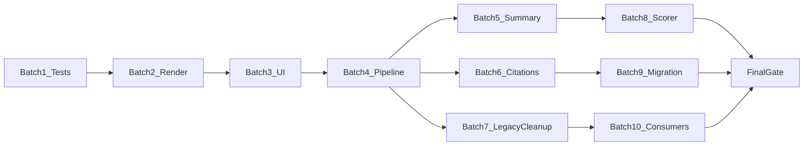

# Clinician Model Card Migration — 100% Closure Plan

## Verified gap snapshot (repo inspection, 2026-07-11)

These audit items **still exist** in the working tree:

| Gap | Verified in |
|-----|-------------|
| `test_source_regulatory.py` uses `regulatory_approval_status_if_applicable` | [`test_source_regulatory.py`](test_source_regulatory.py) — **fails at runtime** (`TypeError`) |
| `test_scoring.py` calls live `CardGenPipeline.generate_model_card` | [`test_scoring.py`](test_scoring.py) |
| No `pytest` in [`requirements.txt`](requirements.txt); no `pytest.ini` | CI does not run tests ([`.github/workflows/main.yml`](.github/workflows/main.yml)) |
| `test_caching.py` hits network/Gemini if collected by pytest | [`test_caching.py`](test_caching.py) |
| DermAUTO title not linked to `application_url` | [`dermauto_card_render.py`](src/core/dermauto_card_render.py) `html.escape(doc_title)` only |
| Nested fields flattened (no dataset/publication/mailto links) | [`card_to_sections()`](src/core/dermauto_card_render.py) lines 245–255 |
| Generator UI flattens nested objects | [`app.py`](src/core/app.py) `display_detailed_sections()` |
| Terminal app uses v0.3 fields + XML path | [`terminal_app.py`](terminal_app.py) |
| Nested fields excluded from agent contract | [`chai_schema.py`](src/core/chai_schema.py) `CLINICAL_CARD_FIELD_NAMES` excludes `training_data`, `performance`, `contact`, etc. |
| Agent still has 74-field `specialized_fields` list | [`agent.py`](src/agents/gemini_agent/agent.py) ~740–756 |
| Post-fill `max_fields=74`, skips nested in `_collect_empty_chai_fields` | [`cardgen_pipeline.py`](src/pipelines/cardgen_pipeline.py) |
| Summary rewrite not implemented (warn-only) | [`clinical_card_mapper.py`](src/pipelines/clinical_card_mapper.py) `enforce_summary_length()` |
| Pipeline writes flat citation sidecar only | [`cardgen_pipeline.py`](src/pipelines/cardgen_pipeline.py) `_write_all()` |
| Dead `_AGENT_TO_CHAI` / `_FALLBACKS` (~400 lines, unused) | [`cardgen_pipeline.py`](src/pipelines/cardgen_pipeline.py) — defined, never indexed |
| Scorer lacks metrics bonus / summary / UNKNOWN rules | [`model_card_scorer.py`](src/utils/model_card_scorer.py) |
| No `test_migration.py` | missing |
| `time_generate_ui_a_cards.py` copies legacy `.md` only | [`scripts/time_generate_ui_a_cards.py`](scripts/time_generate_ui_a_cards.py) |
| `ragas_eval/build_ragas_dataset.py` uses v0.3 markdown paths | [`ragas_eval/build_ragas_dataset.py`](ragas_eval/build_ragas_dataset.py) |
| `swg_intake_field_map.yml` v0.3 keys; loaded only by offline scripts | [`config/swg_intake_field_map.yml`](config/swg_intake_field_map.yml), [`swg_intake.py`](src/core/swg_intake.py) |
| `forms_only.py` 74-field list | [`scripts/forms_only.py`](scripts/forms_only.py) |
| `compute_regulatory_tiers_for_card` tiers every field | [`source_regulatory.py`](src/core/source_regulatory.py) — still called from pipeline |

**Already in place (do not re-implement):**
- Clinical schema, validation, migration script, JSON-first DermAUTO load, render-time citation injection ([`citation_render.py`](src/core/citation_render.py)), regulatory enum row coloring in `render_from_card`, `v03_backup/` archival.



**Hard constraints preserved across all batches:**
- Canonical `.clinical.json` stays marker-free
- Regulatory color only on Regulatory Approval Status row/badge
- Do not edit `preloaded_cards/v03_backup/`
- Migration-only v0.3 parsing retained until Batch 9 tests pass
- No live APIs in unit tests

---

## BATCH 1 — Restore a trustworthy test baseline

### Files to modify
- [`test_source_regulatory.py`](test_source_regulatory.py) — use `regulatory_approval_status=RegulatoryApprovalStatus.FDA_CLEARED` (or string enum); citation key `regulatory_approval_status`; composite key `1) Metadata|||Regulatory Approval Status`
- [`test_scoring.py`](test_scoring.py) — rewrite as pure `ModelCardScorer` unit tests with clinical camelCase fixtures (no pipeline)
- [`requirements.txt`](requirements.txt) or new `requirements-dev.txt` — add `pytest`, `pytest-asyncio`
- New [`pytest.ini`](pytest.ini) — `pythonpath = src`, markers `unit` / `integration`
- New [`scripts/run_clinical_test_suite.sh`](scripts/run_clinical_test_suite.sh) — documented single command
- [`scripts/check_v03_removal_gate.py`](scripts/check_v03_removal_gate.py) — invoke at end of suite (subprocess)
- [`test_caching.py`](test_caching.py) — mark `@pytest.mark.integration` and **exclude from default suite** (or move to `tests/integration/`)

### Tests to add/change
- Fix `test_per_field_tiers_from_citations` (clinical field names)
- Replace `test_scoring.py` async pipeline test with:
  - `test_scorer_clinical_fixture_completion`
  - `test_scorer_respects_weight_sum`
- Ensure pytest collects: `test_clinical_schema.py`, `test_sentence_utils.py`, `test_regulatory_status.py`, `test_citation_render.py`, fixed `test_source_regulatory.py`, rewritten `test_scoring.py`
- **Exclude** from default run: `test_caching.py`, `test_updates.py` (standalone script, not pytest)

### Documented command
```bash
./scripts/run_clinical_test_suite.sh
# equivalent:
PYTHONPATH=src pytest -m unit && PYTHONPATH=src python3 scripts/check_v03_removal_gate.py
```

### Acceptance criteria
- No test references `regulatory_approval_status_if_applicable`
- Default suite: zero network/Gemini/FDA calls
- `pytest -m unit` exits 0
- Gate still passes

### Risks
- `test_citation_render.py` imports migration script — keep as unit (uses `v03_backup/` read-only)

### Rollback point
- Tag `pre-batch-1-tests` before editing test files

### Expected search after Batch 1
- `regulatory_approval_status_if_applicable` in `test_*.py`: **0 matches**

---

## BATCH 2 — Complete DermAUTO rendering

### Files to modify
- [`src/core/dermauto_card_render.py`](src/core/dermauto_card_render.py)
  - Add `card_to_sections_rich(card) -> sections` (or extend `card_to_sections`) producing **pre-HTML-safe plain text + link metadata** per field
  - `render_doc_title(card)` — linked title when `application_url` valid; escaped label text
  - Nested helpers:
    - `format_training_data(td)` — description + optional `[Dataset](url)` style plain text for citation pass
    - `format_development(mdv)` — description + publication link label
    - `format_clinical_trial(ct)` — identifier + linked URL; omit row if all empty
    - `format_contact(c)` — `mailto:` for email, labeled link for url
    - `format_performance_block(perf)` — summary + metrics table HTML (name, value, population, CI)
  - `render_full_card_html` — accept optional `metrics_table_html` section; skip empty optional nested rows
  - Preserve: `html.escape` on text, `linkify_urls` / `linkify_citations` after escape, regulatory tier only on status row
- [`src/core/citation_render.py`](src/core/citation_render.py) — map new field keys (`training_data.description`, `performance.metrics[i]`, etc.) if section keys change

### Tests to add
- New [`test_dermauto_render.py`](test_dermauto_render.py) with **golden HTML snapshots** (inline string constants, not image snapshots):
  - `test_fixture_renders_linked_title`
  - `test_fixture_renders_training_dataset_link`
  - `test_fixture_renders_publication_link`
  - `test_fixture_renders_clinical_trial_links`
  - `test_fixture_renders_contact_mailto_and_url`
  - `test_fixture_renders_performance_metrics_table`
  - `test_empty_optional_nested_fields_omitted`
  - `test_regulatory_color_only_on_status_row`
  - `test_html_escaping_in_nested_fields`

- Shared fixture: `tests/fixtures/clinical_card_full.json` + matching `.citations.json` (marker-free JSON)

### Acceptance criteria
- Full fixture renders all nested types; empty optionals omitted
- Title linked only when `application_url` is non-empty HTTP(S)
- Renderer tests pass under pytest

### Risks
- Metrics table vs citation injection order — inject citations on plain text **before** wrapping in table cells

### Rollback point
- `pre-batch-2-render`

### Expected search after Batch 2
- `html.escape(doc_title)` without link branch: **removed or guarded**

---

## BATCH 3 — Complete generator UI and terminal UI

### Files to modify
- [`src/core/app.py`](src/core/app.py)
  - Replace `display_detailed_sections()` with sectioned rendering mirroring `iter_field_placements()`:
    - Performance metrics as Streamlit table or repeated metric rows
    - Contact: `st.markdown` with mailto + URL links
    - Training/development: description + link columns
    - Regulatory status badge using `REGULATORY_STATUS_LABELS` + `tier_for_regulatory_status` color CSS (badge only, not whole section)
  - Reuse small helpers from `dermauto_card_render` where possible (extract shared `format_*` to new [`src/core/clinical_display.py`](src/core/clinical_display.py) to avoid duplication)
- [`terminal_app.py`](terminal_app.py)
  - Rewrite `print_card_summary()` using `iter_field_placements()` + nested formatters
  - Remove: `release_stage`, `intended_use_and_workflow`, `validation_test_dataset`, `foundation_models_*`, XML print
  - Print artifact paths: `.clinical.json`, `.clinical.md`, `.citations.json`

### Tests to add
- [`test_clinical_display.py`](test_clinical_display.py) — fixture-based string formatting (shared by app + terminal)
- [`test_terminal_summary.py`](test_terminal_summary.py) — capture stdout from `print_card_summary(fixture_card)`; assert no v0.3 field names in output

### Acceptance criteria
- Streamlit + terminal use same 6 sections via `iter_field_placements()`
- No active terminal path reads v0.3 fields
- No XML references
- Nested content not shown as `TrainingData(...)` repr

### Risks
- Streamlit UI not easily pytest-able — keep logic in `clinical_display.py` (pure functions)

### Rollback point
- `pre-batch-3-ui`

### Expected search after Batch 3
- `intended_use_and_workflow` in `terminal_app.py`: **0**
- `xml_path` in `terminal_app.py`: **0**

---

## BATCH 4 — Complete structured agent extraction and post-fill

### Files to modify
- [`src/core/chai_schema.py`](src/core/chai_schema.py) — add `CLINICAL_NESTED_FIELD_SPECS` documenting JSON shapes; adjust `CLINICAL_CARD_FIELD_NAMES` / add `CLINICAL_AGENT_EXTRACT_FIELDS` list including nested top-level keys
- [`src/agents/gemini_agent/prompts.py`](src/agents/gemini_agent/prompts.py) — explicit JSON shapes in `EXTRACTOR` for:
  ```json
  "training_data": {"description": "...", "dataset_url": "..."},
  "performance": {"summary": "...", "metrics": [{"name","value","population","confidence_interval"}]},
  "contact": {"email","url"},
  "model_development_and_validation": {"description","publication_url"},
  "clinical_trial": {"identifier","url","description"}
  ```
- [`src/agents/gemini_agent/agent.py`](src/agents/gemini_agent/agent.py)
  - Remove/replace `specialized_fields` v0.3 list with clinical nested + top-level fields
  - Accept dict values for nested keys in extraction merge (`set_by_path` / direct assign)
- [`src/pipelines/clinical_card_mapper.py`](src/pipelines/clinical_card_mapper.py)
  - Prefer structured agent dicts when present; keep flat legacy fallbacks
  - Add `_coerce_training_data`, `_coerce_performance`, etc.
- [`src/pipelines/cardgen_pipeline.py`](src/pipelines/cardgen_pipeline.py)
  - Rewrite `_collect_empty_chai_fields` → `_collect_empty_clinical_fields` checking nested subfields via spec
  - Replace `max_fields=74` with `max_fields=len(clinical_string_fields)` or capped clinical list
  - Fix `critical_missing` to target subfields (e.g. `performance.summary` empty, `training_data.description` empty)
  - Post-fill: dispatch nested coercers after string fill; never `setattr(card, "training_data", "<string>")`

### Tests to add
- New [`test_pipeline_integration.py`](test_pipeline_integration.py)
  - `test_mock_nested_agent_round_trip` — mock `gemini_run_async` return nested JSON → `generate_model_card(write_files=False)` → assert `ClinicalModelCard` nested types
  - `test_mock_flat_legacy_agent_fallback` — flat v0.3-like keys still map
  - `test_collect_empty_detects_nested_gaps`
  - `test_postfill_does_not_stringify_nested_objects`

### Acceptance criteria
- Mocked nested + flat paths pass without network
- Post-fill never assigns undifferentiated string to nested dataclass fields

### Risks
- Post-fill Gemini prompts need field-specific instructions for nested JSON — update `_postfill_one_field` prompt templates in `cardgen_pipeline.py`

### Rollback point
- `pre-batch-4-pipeline`

### Expected search after Batch 4
- `max_fields=74` in `cardgen_pipeline.py`: **0**

---

## BATCH 5 — Finish summary enforcement

### Files to modify
- [`src/pipelines/clinical_card_mapper.py`](src/pipelines/clinical_card_mapper.py)
  - Extend `enforce_summary_length(card, rewrite_callback=None)`:
    1. if `count_sentences <= 3`: pass
    2. elif `rewrite_callback`: call → revalidate → accept if ≤3
    3. else: keep original + `summary_exceeds_three_sentences` warning
    4. **never truncate**
- [`src/pipelines/cardgen_pipeline.py`](src/pipelines/cardgen_pipeline.py) — inject optional `_rewrite_summary_callback` (Gemini) in production; pass `None` in tests
- [`src/utils/sentence_utils.py`](src/utils/sentence_utils.py) — unchanged (sole sentence counter)

### Tests to add
- [`test_summary_enforcement.py`](test_summary_enforcement.py)
  - `test_no_callback_warns_preserves_original`
  - `test_callback_success_replaces_summary`
  - `test_callback_still_too_long_keeps_original`
  - `test_no_truncation_path_exists` (assert long summary byte-identical after enforce)

### Acceptance criteria
- No silent truncation anywhere
- Warnings recorded in validation output

### Rollback point
- `pre-batch-5-summary`

---

## BATCH 6 — Finish citation generation fidelity

### Files to modify
- New [`src/core/citation_sidecar.py`](src/core/citation_sidecar.py)
  - `build_sidecar_from_evidence(card, evidence_by_field) -> dict` with stable `references` IDs (URL-keyed) + `field_citations` spans from evidence snippets
  - `align_snippet_to_field_text(field_text, snippet) -> span or None`; emit warning when alignment fails
- [`src/pipelines/cardgen_pipeline.py`](src/pipelines/cardgen_pipeline.py) — call builder before `_write_all`; merge with FDA/regulatory attachments
- [`src/core/citation_render.py`](src/core/citation_render.py) — prefer exact spans; log warning when falling back to `sentence_level`; never emit clickable marker without reference ID
- Keep JSON canonical (no inline markers)

### Tests to add
- Extend [`test_citation_render.py`](test_citation_render.py) + new [`test_citation_sidecar.py`](test_citation_sidecar.py):
  - one / multiple / repeated source reuse
  - nonmatching span → warning + fallback behavior
  - missing sidecar / missing reference ID
  - flat legacy `fields`-only sidecar still works

### Acceptance criteria
- Mocked pipeline fixture produces `field_citations` entries
- Exact spans used when snippet matches; heuristic only with warning

### Rollback point
- `pre-batch-6-citations`

---

## BATCH 7 — Clean active legacy pipeline code

### Files to modify
- [`src/pipelines/cardgen_pipeline.py`](src/pipelines/cardgen_pipeline.py) — delete `_AGENT_TO_CHAI`, `_FALLBACKS` (~lines 171–650)
- [`src/agents/gemini_agent/agent.py`](src/agents/gemini_agent/agent.py) — remove remaining v0.3 field name lists in extraction loops
- Replace active imports:
  - `CHAIModelCard` → `ClinicalModelCard` in [`cardgen_pipeline.py`](src/pipelines/cardgen_pipeline.py), [`app.py`](src/core/app.py), [`agent.py`](src/agents/gemini_agent/agent.py), [`source_regulatory.py`](src/core/source_regulatory.py)
  - `iter_chai_field_placements` → `iter_field_placements` in [`source_regulatory.py`](src/core/source_regulatory.py)
- [`src/core/chai_schema.py`](src/core/chai_schema.py) — keep `CHAIModelCard` alias **only** with comment `DEPRECATED: remove after Batch 10`; keep `iter_chai_field_placements` alias until Batch 10 confirms zero imports

### Tests
- Re-run full unit suite — no behavior change expected

### Acceptance criteria
- Active runtime search (excluding `scripts/migrate_*`, `v03_backup/`, `preloaded_cards/*.md`, `clinical_migrated/`, `forms_only.py` if deprecated, `ragas_eval/` if deprecated):
  - `_AGENT_TO_CHAI`: 0
  - `iter_chai_field_placements` imports in `src/`: 0
  - `intended_use_and_workflow`, `release_stage`, `key_metrics` in `src/`: 0 except `clinical_card_mapper` legacy fallback reads

### Rollback point
- `pre-batch-7-cleanup` (large deletions — easy revert via git)

---

## BATCH 8 — Complete scorer migration

### Files to modify
- [`src/utils/model_card_scorer.py`](src/utils/model_card_scorer.py)
  - Score each `performance.metrics[]` entry (name+value required)
  - Bonus: +bounded boost when ≥1 meaningful metric (cap so total ≤ 1.0)
  - Deduction: summary >3 sentences (use `count_sentences` from `sentence_utils`)
  - UNKNOWN handling: penalize **unsupported certainty phrases** in `regulatory_approval_status` text field when enum is UNKNOWN (e.g. "FDA cleared" prose with UNKNOWN enum) — **do not** penalize honest UNKNOWN alone
  - Clamp final scores to [0, 1]
- [`test_scoring.py`](test_scoring.py) — deterministic clinical fixtures covering metrics bonus, summary penalty, UNKNOWN vs false certainty

### Acceptance criteria
- Scores stay in documented bounds
- Valid metrics improve or preserve score
- Honest UNKNOWN not penalized; contradictory prose is

### Rollback point
- `pre-batch-8-scorer`

---

## BATCH 9 — Migration robustness and preload hygiene

### Files to modify
- New [`test_migration.py`](test_migration.py) using `tmp_path` + copy of one `v03_backup/*.md`:
  - `test_dry_run_no_writes`
  - `test_apply_writes_clinical_bundle`
  - `test_idempotent_second_run_same_hash`
  - `test_unmatched_markers_warn`
  - `test_sidecar_reference_ids_resolve`
- [`scripts/migrate_v03_to_clinical_cards.py`](scripts/migrate_v03_to_clinical_cards.py) — ensure first run never overwrites originals (already writes to `clinical_migrated/`; add explicit guard if `--apply` target exists without checksum match)
- [`src/core/pages/03_DermAUTO_Card.py`](src/core/pages/03_DermAUTO_Card.py)
  - Sidebar: enumerate **clinical bundles** explicitly (`*.clinical.json` stems), not legacy `.md` filenames
  - One entry per model (A/B variants by stem map)
- [`scripts/time_generate_ui_a_cards.py`](scripts/time_generate_ui_a_cards.py)
  - Copy/write `*.clinical.json`, `*.clinical.md`, `*.citations.json` to preloaded dir
  - **Do not** write bare `dermgpt-*.md` v0.3-style filenames
- [`scripts/check_v03_removal_gate.py`](scripts/check_v03_removal_gate.py) — add `test_migration.py` to gate

### Acceptance criteria
- Migration idempotent in tests
- Sidebar shows one active card per model label
- Regen script writes full clinical bundle

### Risks
- Gate currently counts `clinical_migrated/*.clinical.json` toward ">=6" — tighten to `preloaded_cards/*.clinical.json` only after hygiene

### Rollback point
- `pre-batch-9-migration`

### Expected search after Batch 9
- `time_generate_ui_a_cards.py` copying only `.md`: **0** (must copy clinical bundle)

---

## BATCH 10 — Remaining repository consumers

### A. [`ragas_eval/build_ragas_dataset.py`](ragas_eval/build_ragas_dataset.py)
**Status:** Active offline eval tooling (referenced by `ragas_eval/run_ragas_eval.py`), **not** imported by app/pipeline.

**Action:** Migrate to clinical JSON + camelCase/snake field keys; update `UI_CARD_FILES` to `*.clinical.json`; add `DEPRECATED_v03` comment block at top of old path. Add [`test_ragas_dataset_builder.py`](test_ragas_dataset_builder.py) with fixture clinical JSON (offline).

**If migration too heavy:** Mark module `DEPRECATED — use clinical JSON`; update [`ragas_eval/README`](docs/README.md) or local README — **user rule says prove inactive OR migrate**; migration is in scope.

### B. [`config/swg_intake_field_map.yml`](config/swg_intake_field_map.yml)
**Status:** Loaded only by [`scripts/infer_swg_intake_mapping.py`](scripts/infer_swg_intake_mapping.py) and [`src/core/swg_intake.py`](src/core/swg_intake.py) — **not** loaded by generator runtime.

**Action:** Replace section keys with clinical `section|||label` placements from `iter_field_placements()`; add [`config/CLINICAL_SWG_DEFERRED.md`](config/CLINICAL_SWG_DEFERRED.md) only if runtime remains unconnected (document deferral).

### C. [`scripts/forms_only.py`](scripts/forms_only.py)
**Status:** Standalone script, not imported by runtime.

**Action:** Replace `CHAI_FIELDS` with clinical field list + nested builders; add `if __name__` guard raising clear error when 74-field mode requested; or deprecate with `sys.exit("Use CardGenPipeline")` at start — **prefer clinical field rewrite** per plan Phase 7.

### D. [`src/core/source_regulatory.py`](src/core/source_regulatory.py)
**Action:**
- Narrow `compute_regulatory_tiers_for_card` to attach metadata only OR restrict composite tiers to regulatory status row key
- Remove pipeline dependency on per-field coloring ([`cardgen_pipeline.py`](src/pipelines/cardgen_pipeline.py) call can remain for citation metadata only)
- Enum-first:`card_regulatory.regulatory_tier_for_card` remains authoritative for UI

### Acceptance criteria
- Each consumer migrated **or** documented inactive with no runtime import path
- `compute_regulatory_tiers_for_card` does not drive non-status row colors

### Rollback point
- `pre-batch-10-consumers`

---

## FINAL ACCEPTANCE GATE

Run after Batch 10:

```bash
./scripts/run_clinical_test_suite.sh   # pytest -m unit + gate + test_migration.py
```

Manual smoke (offline mocked):
- `test_pipeline_integration.py` asserts artifact triple: `.clinical.json`, `.clinical.md`, `.citations.json`
- `test_dermauto_render.py` golden HTML covers linked title, nested links, metrics, citations
- `test_migration.py` idempotency

Repository search script (add [`scripts/audit_v03_runtime.sh`](scripts/audit_v03_runtime.sh)):
```bash
rg 'regulatory_approval_status_if_applicable|intended_use_and_workflow|release_stage|key_metrics|_AGENT_TO_CHAI' \
  src/ test_*.py --glob '!scripts/migrate*' 
# expect 0 matches in src/ and test_*.py
```

**Migration complete when all 12 final gate bullets pass** and no audit item remains PARTIAL / NOT IMPLEMENTED.

---

## Batch dependency and approval workflow

| Batch | Depends on | Approve before starting |
|-------|------------|------------------------|
| 1 | — | Yes (blocks all) |
| 2 | 1 | Yes |
| 3 | 2 (shared formatters optional parallel with 2) | Yes |
| 4 | 1 | Yes (can parallel 2–3 after 1) |
| 5 | 4 | Yes |
| 6 | 4 | Yes |
| 7 | 4, 5, 6 | Yes |
| 8 | 1, 4 | Yes |
| 9 | 1, 6 | Yes |
| 10 | 7, 9 | Yes |

**Recommended execution order:** 1 → 2 → 3 → 4 → 5 & 6 (parallel) → 7 → 8 → 9 → 10 → Final gate.

Do not start implementation until you approve this plan (whole plan or batch-by-batch).
