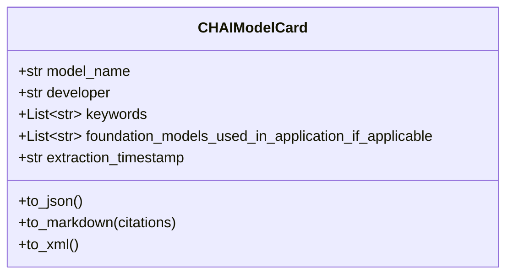
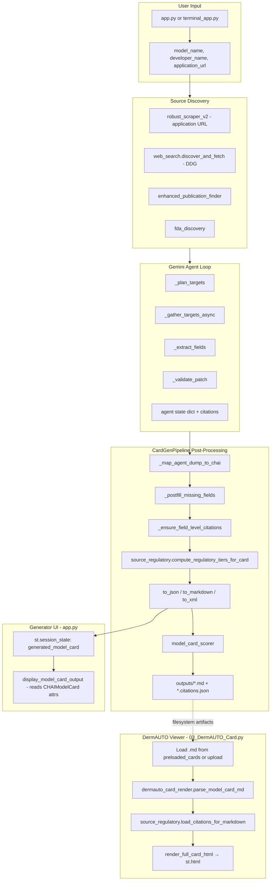

# Model Card Implementation — Architecture Reference

**Status:** Read-only analysis. No changes will be made until you confirm.

---

## 1. Every File Involved

The model card system has two UIs and one generation pipeline, all centered on [`CHAIModelCard`](src/core/chai_schema.py).

### Core schema and rendering

| File | Role |
|------|------|
| [`src/core/chai_schema.py`](src/core/chai_schema.py) | **Single source of truth** — `CHAIModelCard` dataclass, `iter_chai_field_placements()`, `to_json()` / `to_markdown()` / `to_xml()` |
| [`src/core/dermauto_card_render.py`](src/core/dermauto_card_render.py) | Markdown parser, citation renumbering, HTML renderer (`render_full_card_html`) |
| [`src/core/card_regulatory.py`](src/core/card_regulatory.py) | Text-based regulatory tier classification (green/yellow/blue/orange/red/gray) |
| [`src/core/source_regulatory.py`](src/core/source_regulatory.py) | Citation/URL-based regulatory tiers; loads `.citations.json` sidecars |
| [`config/swg_intake_field_map.yml`](config/swg_intake_field_map.yml) | SWG intake spreadsheet column → CHAI field mapping |

### Generation pipeline and AI agent

| File | Role |
|------|------|
| [`src/pipelines/cardgen_pipeline.py`](src/pipelines/cardgen_pipeline.py) | **Main orchestrator** — discovery, agent loop, post-fill, citations, regulatory tagging, file export, scoring |
| [`src/agents/gemini_agent/agent.py`](src/agents/gemini_agent/agent.py) | Iterative Gemini agent: plan → fetch → extract → validate |
| [`src/agents/gemini_agent/prompts.py`](src/agents/gemini_agent/prompts.py) | Planner, extractor, validator prompt templates |
| [`src/agents/gemini_agent/tools.py`](src/agents/gemini_agent/tools.py) | DDG search, HF/GitHub fetch, JSON extraction |

### Streamlit UIs and entry points

| File | Role |
|------|------|
| [`src/core/app.py`](src/core/app.py) | **Generator UI** — user input → pipeline → session state → inline HTML preview + downloads |
| [`src/core/pages/03_DermAUTO_Card.py`](src/core/pages/03_DermAUTO_Card.py) | **DermAUTO viewer** — reads preloaded/uploaded `.md` → parsed HTML with regulatory coloring |
| [`run_app.py`](run_app.py) | Launcher (Streamlit or CLI) |
| [`terminal_app.py`](terminal_app.py) | CLI wrapper around `CardGenPipeline` |
| [`sitecustomize.py`](sitecustomize.py) | Adds `src/` to `sys.path` at repo root |

### Discovery, scraping, enrichment, scoring

| File | Role |
|------|------|
| [`src/utils/web_search.py`](src/utils/web_search.py) | DuckDuckGo discovery + async HTML/PDF fetch |
| [`src/scrapers/robust_scraper_v2.py`](src/scrapers/robust_scraper_v2.py) | Second-hop scraper for user-supplied application URLs |
| [`src/scrapers/selenium_scraper.py`](src/scrapers/selenium_scraper.py) | JS-rendered page fallback |
| [`src/utils/enhanced_publication_finder.py`](src/utils/enhanced_publication_finder.py) | Crossref + arXiv publication discovery |
| [`src/utils/fda_discovery.py`](src/utils/fda_discovery.py) | FDA 510(k) API lookup |
| [`src/utils/model_card_scorer.py`](src/utils/model_card_scorer.py) | Post-generation completeness and clinical usability scoring |
| [`src/utils/cache_system.py`](src/utils/cache_system.py) | Caches scraped content and agent planning |
| [`src/utils/net.py`](src/utils/net.py) | Shared aiohttp helpers |
| [`src/ai_extractors/ai_extractor.py`](src/ai_extractors/ai_extractor.py) | Standalone Gemini extractor (used by publication finder) |
| [`config/config.py`](config/config.py) | Gemini model, concurrency, API key settings |

### SWG intake bridge

| File | Role |
|------|------|
| [`src/core/swg_intake.py`](src/core/swg_intake.py) | Reads SWG industry intake XLSX |
| [`scripts/forms_only.py`](scripts/forms_only.py) | Builds cards from intake forms (no full LLM pipeline) |
| [`scripts/infer_swg_intake_mapping.py`](scripts/infer_swg_intake_mapping.py) | Infers column → CHAI field mappings |

### Scripts, tests, evaluation

| File | Role |
|------|------|
| [`scripts/time_generate_ui_a_cards.py`](scripts/time_generate_ui_a_cards.py) | Regenerates preloaded "A" cards |
| [`cache_inspector.py`](cache_inspector.py) | Debug cache export/clear |
| [`test_scoring.py`](test_scoring.py), [`test_regulatory_status.py`](test_regulatory_status.py), [`test_source_regulatory.py`](test_source_regulatory.py), [`test_updates.py`](test_updates.py), [`test_caching.py`](test_caching.py) | Tests |
| [`ragas_eval/build_ragas_dataset.py`](ragas_eval/build_ragas_dataset.py) | RAGAS eval dataset from DermAUTO cards |

### Card artifacts (data, not code)

- **Preloaded:** [`src/core/pages/preloaded_cards/*.md`](src/core/pages/preloaded_cards/) (6 cards: DermaSensor, DermGPT, Tandem — A autogenerated + B manual)
- **Pipeline output:** [`outputs/*.md`](outputs/) (+ `.json`, `.xml`, `.citations.json`, `.scoring.txt`)

### Recently removed (in-progress refactor per git status)

- `src/core/card_provenance.py` → replaced by `source_regulatory.py` + `card_regulatory.py`
- `src/utils/citation_system.py` → logic moved into pipeline + `source_regulatory.py`
- `src/scrapers/scraping.py` → superseded by `robust_scraper_v2.py`

---

## 2. Current Data Model

### Primary: `CHAIModelCard` (CHAI Applied Model Card v0.3)

Defined in [`src/core/chai_schema.py`](src/core/chai_schema.py) as a flat `@dataclass` with **74 total attributes** (73 CHAI content fields + `extraction_timestamp`).



**Field types:**
- Most fields: `str` (default `""`)
- List fields: `keywords`, `foundation_models_used_in_application_if_applicable`
- Meta: `extraction_timestamp` (ISO datetime string)

**Placement contract:** `iter_chai_field_placements()` yields `(markdown_section, field_name, display_label)` tuples. This order is shared by markdown export, regulatory tier keys (`section|||label`), and the DermAUTO markdown parser.

### Secondary structures (not in the dataclass)

**Citations dict** (per-field provenance, written to `.citations.json`):
```python
{
  "<field_name>": [{"url": str, "snippet": str, "source_type"?: str, "regulatory_tier"?: str}],
  "postfill.<field_name>": [...],
  "_sources_metadata": {url: {"usage": str, "reason": str}},
  "_regulatory_tiers": {field_name: tier},
  "_regulatory_tiers_composite": {"section|||label": tier},
}
```

**Pipeline return tuple:** `(CHAIModelCard, sources: dict, content: dict)`
- `sources`: agent metadata, citations, web_search results, publications, FDA records, scoring
- `content`: serialized `json`/`markdown`/`xml` strings, file paths, scoring report

**DermAUTO parsed shape:**
```python
sections: Dict[str, Dict[str, str]]   # section title → display label → value
refs: Dict[int, str]                  # reference number → URL
regulatory_by_key: Dict[str, str]     # "section|||label" → tier color
```

**Regulatory tiers:** `green | yellow | blue | orange | red | gray`

---

## 3. Data Flow: AI Generation → UI



### Key flow notes

1. **Generation is self-contained in `CardGenPipeline.generate_model_card()`** — `app.py` calls it via `asyncio.run()`; discovery inside the pipeline is the real work (the separate `extract_content_from_sources()` in `app.py` is a placeholder for progress UI).

2. **Two UIs are decoupled:**
   - **Generator** ([`app.py`](src/core/app.py)): holds live `CHAIModelCard` in `st.session_state`, renders its own gradient HTML cards directly from dataclass attributes.
   - **DermAUTO viewer** ([`03_DermAUTO_Card.py`](src/core/pages/03_DermAUTO_Card.py)): does **not** call the pipeline; reads markdown files and optionally `.citations.json` sidecars. Uses **no session state**.

3. **The bridge between them is filesystem artifacts** (`outputs/*.md`, `preloaded_cards/*.md`), not shared in-memory state.

4. **Transform chain (generation path):**

| Step | Function | File |
|------|----------|------|
| Web discovery | `discover_and_fetch` | `web_search.py` |
| App URL scrape | `RobustWebScraper.extract_content_with_second_hop` | `robust_scraper_v2.py` |
| Agent extract | `run_async` → `_extract_fields` | `agent.py` |
| Agent → CHAI | `_map_agent_dump_to_chai` | `cardgen_pipeline.py` |
| Post-fill | `_postfill_missing_fields` | `cardgen_pipeline.py` |
| Citations | `_ensure_field_level_citations` | `cardgen_pipeline.py` |
| Regulatory | `compute_regulatory_tiers_for_card` | `source_regulatory.py` |
| Serialize | `to_markdown(citations)` | `chai_schema.py` |
| Score | `ModelCardScorer.score_model_card` | `model_card_scorer.py` |

5. **Transform chain (viewer path):**

| Step | Function | File |
|------|----------|------|
| Normalize MD | `normalize_md_for_parsing` | `dermauto_card_render.py` |
| Parse refs | `parse_references`, `build_ref_renumbering` | `dermauto_card_render.py` |
| Parse sections | `parse_model_card_md` | `dermauto_card_render.py` |
| Regulatory colors | `load_citations_for_markdown`, `compute_regulatory_for_sections` | `source_regulatory.py`, `card_regulatory.py` |
| Render HTML | `render_full_card_html` | `dermauto_card_render.py` |

---

## 4. All Current Fields (74)

### 1) Metadata (11)
`model_name`, `developer`, `application_url`, `inquiries_or_to_report_an_issue`, `release_stage`, `release_date`, `version`, `regulatory_approval_status_if_applicable`, `global_availability`, `summary`, `keywords` *(List[str])*

### 2) Uses and Directions (6)
`intended_use_and_workflow`, `primary_intended_users`, `necessary_knowledge_expertise`, `how_to_use`, `targeted_patient_population`, `patient_consent_or_disclosure_required_or_suggested`

### 3) Warnings (4)
`developer_supplied_warnings`, `model_limitations`, `skin_type_representation_and_equity`, `clinical_risk_level`

### 4) Trust Ingredients (28)
`ai_system_facts`, `model_type`, `interaction_with_other_systems`, `outcomes_and_output`, `type_and_value_of_solution_output`, `explanation_for_how_an_output_is_generated`, `foundation_models_used_in_application_if_applicable` *(List[str])*, `input_data_source`, `output_input_data_type`, `development_data_characterization`, `training_data`, `exclusion_inclusion_criteria`, `demographic_representativeness`, `dataset_doi_if_applicable`, `dataset_transparency`, `validation_test_dataset`, `timeline_of_data_collection`, `skin_tone_diversity`, `did_the_data_collection_process_undergo_ethical_review`, `ethical_review_board_oversight`, `irb_approval`, `relevance_of_training_data_to_intended_population`, `bias_mitigation_approaches`, `ongoing_maintenance`, `security_and_compliance_environment_practices_or_accreditations_if_applicable`, `transparency_intelligibility_and_accountability_mechanisms_if_applicable`, `transparency_information`, `funding_source_of_the_technical_implementation`, `third_party_information_if_applicable`

### 5) Key Metrics — Usefulness / Efficacy (7)
`usefulness_efficacy_goal_of_metrics`, `usefulness_efficacy_result`, `usefulness_efficacy_interpretation`, `usefulness_efficacy_test_type`, `usefulness_efficacy_testing_data_description`, `usefulness_efficacy_validation_process_and_justification`, `usefulness_efficacy_auroc_accuracy_etc`

### 5) Key Metrics — Fairness and Equity (6)
`fairness_equity_goal_of_metrics`, `fairness_equity_result`, `fairness_equity_interpretation`, `fairness_equity_test_type`, `fairness_equity_testing_data_description`, `fairness_equity_validation_process_and_justification`

### 5) Key Metrics — Safety and Reliability (6)
`safety_reliability_goal_of_metrics`, `safety_reliability_result`, `safety_reliability_interpretation`, `safety_reliability_test_type`, `safety_reliability_testing_data_description`, `safety_reliability_validation_process_and_justification`

### 6) Resources (5)
`evaluation_references_if_available`, `clinical_trial_if_available`, `peer_reviewed_publications`, `reimbursement_status_if_applicable`, `stakeholders_consulted_during_design_of_solution`

### Generation metadata (1)
`extraction_timestamp`

---

## 5. Which Files Will Need Modification

Depends on the type of change. Below is a change-type → file map. **No edits are planned until you confirm what you want to change.**

### In-progress refactor (already modified in working tree)

These files have uncommitted changes related to regulatory/citation consolidation:
- [`src/core/source_regulatory.py`](src/core/source_regulatory.py) *(new)*
- [`src/core/card_regulatory.py`](src/core/card_regulatory.py)
- [`src/core/chai_schema.py`](src/core/chai_schema.py)
- [`src/pipelines/cardgen_pipeline.py`](src/pipelines/cardgen_pipeline.py)
- [`src/core/pages/03_DermAUTO_Card.py`](src/core/pages/03_DermAUTO_Card.py)
- [`test_regulatory_status.py`](test_regulatory_status.py), [`test_source_regulatory.py`](test_source_regulatory.py) *(new)*

### By change type

**Add or rename a CHAI field:**
1. [`src/core/chai_schema.py`](src/core/chai_schema.py) — dataclass field + `iter_chai_field_placements()` + `to_markdown()`/`to_xml()` lines
2. [`src/pipelines/cardgen_pipeline.py`](src/pipelines/cardgen_pipeline.py) — `_AGENT_TO_CHAI` mapping, post-fill, citation enforcement
3. [`src/agents/gemini_agent/prompts.py`](src/agents/gemini_agent/prompts.py) — field list in prompts (derived from `CHAIModelCard` fields)
4. [`src/utils/model_card_scorer.py`](src/utils/model_card_scorer.py) — field weights/completion checks
5. [`src/core/dermauto_card_render.py`](src/core/dermauto_card_render.py) — parser must recognize new section/label
6. [`src/core/source_regulatory.py`](src/core/source_regulatory.py) — regulatory tier keys use `iter_chai_field_placements()`
7. [`src/core/app.py`](src/core/app.py) — `display_model_card_output()` if field has custom display
8. Tests + [`config/swg_intake_field_map.yml`](config/swg_intake_field_map.yml) if intake-mapped

**Change generation / extraction logic only:**
- [`src/pipelines/cardgen_pipeline.py`](src/pipelines/cardgen_pipeline.py)
- [`src/agents/gemini_agent/agent.py`](src/agents/gemini_agent/agent.py), [`prompts.py`](src/agents/gemini_agent/prompts.py), [`tools.py`](src/agents/gemini_agent/tools.py)
- [`src/utils/web_search.py`](src/utils/web_search.py), scrapers, [`fda_discovery.py`](src/utils/fda_discovery.py)

**Change DermAUTO viewer appearance only:**
- [`src/core/pages/03_DermAUTO_Card.py`](src/core/pages/03_DermAUTO_Card.py)
- [`src/core/dermauto_card_render.py`](src/core/dermauto_card_render.py)

**Change generator UI (app.py) only:**
- [`src/core/app.py`](src/core/app.py)

**Change regulatory tier logic:**
- [`src/core/card_regulatory.py`](src/core/card_regulatory.py) — text-based classification
- [`src/core/source_regulatory.py`](src/core/source_regulatory.py) — URL/source-type classification
- [`src/core/pages/03_DermAUTO_Card.py`](src/core/pages/03_DermAUTO_Card.py) — toggle and wiring

**Change citation / provenance behavior:**
- [`src/pipelines/cardgen_pipeline.py`](src/pipelines/cardgen_pipeline.py)
- [`src/core/source_regulatory.py`](src/core/source_regulatory.py)
- [`src/core/chai_schema.py`](src/core/chai_schema.py) — `to_markdown(citations=...)`

**Regenerate example cards:**
- [`scripts/time_generate_ui_a_cards.py`](scripts/time_generate_ui_a_cards.py)
- [`src/core/pages/preloaded_cards/*.md`](src/core/pages/preloaded_cards/)

---

## Central Hub

Everything flows through **`CHAIModelCard`** in [`src/core/chai_schema.py`](src/core/chai_schema.py):

- **Filled by:** `CardGenPipeline` + Gemini agent
- **Exported as:** JSON / Markdown / XML + `.citations.json` sidecar
- **Scored by:** `ModelCardScorer`
- **Displayed by:** `app.py` (live object) or `03_DermAUTO_Card.py` (parsed markdown)

**Awaiting your confirmation** before any code changes. Tell me what you'd like to modify (e.g., add fields, change UI, finish the regulatory refactor) and I can proceed.
